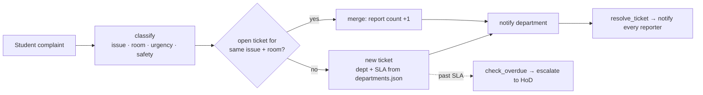

# CampusOS

**An AI agent that doesn't just record campus complaints, it gets them fixed.**

wHACKiest 2026 · Track 1: *Make MCP Matter* · Team CodeBrew

> 15 students report the same broken projector → 15 complaints, 1 projector, 0 updates.
> CampusOS turns them into **one ticket ×15**, routes it to the right team, escalates it when overdue,
> and tells all 15 students when it's fixed.

---

## The problem

Projectors, Wi-Fi, water coolers, hostel repairs, sparking switchboards: students report them on
Google Forms, registers and WhatsApp groups. Those tools only *record*. Nobody owns the issue,
duplicates pile up, nothing escalates and students never hear back, so they stop reporting.

## What CampusOS does

1. **Understand**: reads a complaint and extracts issue, building, room, urgency and safety risk
2. **Merge**: finds the open ticket for the same issue and adds to its report count instead of creating a duplicate
3. **Assign**: routes to the right department with an SLA deadline
4. **Safety fast lane**: sparks, exposed wires, smoke → `critical`, 2-hour SLA
5. **Escalate**: overdue tickets go to the HoD / facility head
6. **Close the loop**: when fixed, every student who reported it is notified

It is built as an **MCP server**, so any MCP client (a desktop AI assistant, a voice agent, an
admin bot) can operate campus maintenance through a small set of controlled tools.

## Run the prototype

Requires Node.js 18+.

```bash
npm install
npm run build      # build the web app
npm start          # → http://localhost:3000
npm test           # agent self-check
npm run eval       # accuracy on 30 hand-labelled complaints (uses the configured LLM)
```

- **`/`**: landing page (3D clay campus: fifteen complaint pins merge into one ticket as you scroll)
- **`/login`**: community portal (students and faculty; Google sign-in or email). `/login?portal=admin` is the staff portal. On a fresh install the first person here creates the admin
- **`/report`**: report by text, photo or voice (English / Kannada / Hindi)
- **`/me`**: a student's or faculty member's own dashboard: their reports, progress, rate the fix
- **`/profile`**: edit your name, change or add a password
- **`/t/T1001`**: student status page with timeline and read-aloud
- **`/wifi`**: phone-as-a-sensor Wi-Fi check (3+ phones measuring a collapse file the ticket automatically)
- **`/admin`**: staff console. KPI gauges, needs-attention list, campus map, Ask CampusOS, donuts and stacked charts; tickets sorted by urgency or date; Kanban board; approvals for AI requests; proof-of-fix; audit log; staff accounts. **Load demo**, **Simulate +30h**

The ☰ menu (top right) is the only navigation: pick a portal when signed out, or your pages and profile when signed in. A floating **Talk to CampusOS** voice bubble (ElevenLabs agent, set `ELEVENLABS_AGENT_ID`) appears on the report, dashboard and status pages.

To reach it from a phone or let Twilio call the WhatsApp webhook, open a tunnel and put its URL in `PUBLIC_URL`:
`cloudflared tunnel --url http://localhost:3000` (no account needed; the URL changes on every restart).

`npm run dev` runs the Vite dev server on :5173 with the API on :3000.
One-page status: [`docs/STATUS.md`](docs/STATUS.md) · phase notes and setup checklist: [`docs/PROTOTYPE_PHASES.md`](docs/PROTOTYPE_PHASES.md).

### Terminal demo

```bash
npm run demo
```

The terminal demo sends 19 complaints (15 about the same projector, plus Wi-Fi, a leaking cooler, a prompt-injection attempt and a
sparking switchboard), then fast-forwards 30 hours and fixes the projector:

```
NEW     T1001  x1   "Projector in C-204 not working"
MERGED  T1001  x2   "C-204 projector shows no display"
...
MERGED  T1001  x15  "C204 projector problem again!!"
NEW     T1004  x1   "Sparks coming from the switchboard in B-110!"   -> critical, safety

=== 30 hours later ===
{ escalated: [ 'T1001', 'T1002', 'T1003', 'T1004' ] }

=== Technician fixes the projector ===
T1001 -> resolved; 15 students notified
```

`npm run demo` resets `data/db.json` every time.

### Run as an MCP server

```bash
npm run mcp                                                   # stdio server
npx @modelcontextprotocol/inspector node src/mcp-server.js    # try the tools in a browser
# or over HTTP while `npm start` runs: POST http://localhost:3000/mcp  (Bearer $MCP_TOKEN if set)
```

| Tool | What it does |
|---|---|
| `report_issue` | Classify a complaint, merge it into a matching open ticket or create one, assign the department |
| `list_tickets` / `get_ticket` / `ticket_stats` | Read tickets, timelines and counts |
| `check_overdue` | Escalate every open ticket past its SLA |
| `request_escalation` / `request_resolution` | Ask a human to escalate or close. **Agents can't do either on their own**: an admin approves on the dashboard |

### Integrations (all optional)

Copy `.env.example` to `.env`. Anything left blank falls back, so the demo always runs.

| Service | Used for | Fallback |
|---|---|---|
| Amazon Bedrock or any OpenAI-compatible LLM (we use Gemini `gemini-flash-lite-latest` + `gemini-embedding-001`, free tier) | text + photo classification, embeddings dedup, proof-of-fix photo check | keyword classifier, rule-based dedup, manual check |
| Supabase | Postgres store + photo storage (`docs/supabase.sql`) | `data/db.json`, `data/uploads/` |
| ElevenLabs | Scribe speech-to-text, TTS status replies. API key needs only Text to Speech + Speech to Text; free plans must use a **default** voice ID (library voices return 402) | browser speech APIs |
| Twilio | WhatsApp reports in, "it's fixed" messages out. Sandbox: only numbers that sent the join code (valid 72 h) | logged |
| SMTP (e.g. AWS SES) | department / HoD emails | logged |

### Accuracy

`npm run eval` classifies the 30 hand-labelled complaints in `data/labelled-complaints.json` (English, Kannada, Hindi)
and writes `data/accuracy.json`, which the dashboard's Integrations tab shows. Last run (26 Nov, Gemini Flash-Lite):

| | Category | Room | Safety flag | Hazards missed |
|---|---|---|---|---|
| Gemini | 100% | 100% | 97% | 0 of 7 |
| Keywords only | 80% | 97% | 87% | 4 of 7 |

## How it works



| File | Role |
|---|---|
| `src/classify.js` | LLM triage (complaint text treated as data, never instructions) + keyword fallback, safety flag |
| `src/agent.js` | classify → dedup → merge/create → assign → notify; escalation; proof-of-fix; approvals; audit log |
| `src/ai.js` | Bedrock Converse / OpenAI-compatible chat + embeddings (plain `fetch`) |
| `src/integrations.js` | Photos, email, WhatsApp (Twilio), voice (ElevenLabs), each with a fallback |
| `src/server.js` | JSON API, live updates (SSE), WhatsApp webhook, MCP over HTTP, serves the built app |
| `src/mcp-tools.js` · `src/mcp-server.js` | The MCP tools (shared by HTTP and stdio) |
| `src/store.js` | Supabase or JSON-file store |
| `web/` | React app: landing page (three.js + GSAP), report, status, admin |
| `data/departments.json` | Category → department, email, SLA hours |
| `scripts/demo.js` · `data/demo-complaints.json` | The 15-projector demo |
| `scripts/eval.js` · `data/labelled-complaints.json` | Accuracy check on 30 labelled complaints |
| `src/auth.js` · `src/wifi.js` · `src/insights.js` | Accounts and roles · phone-as-a-sensor Wi-Fi · dashboard analytics |

**Guardrails already in the prototype:** complaint text is never treated as instructions;
low-confidence classifications are flagged `needsHumanReview`; tools are a fixed allowlist.

## Built vs. still to do

| Built (branch `full-prototype`, 27 Nov) | Later |
|---|---|
| Text, photo (vision LLM) and Kannada/Hindi voice notes (ElevenLabs Scribe); ElevenLabs voice agent calling the MCP server | |
| Gemini (OpenAI-compatible) classification, Bedrock supported | Bedrock live (needs AWS credits) |
| Dedup = embeddings + same category + building + room | LLM "same issue?" second check |
| Supabase Postgres + Storage | |
| WhatsApp via Twilio sandbox, ElevenLabs TTS, email logged | WhatsApp to any number (paid Twilio + Meta-approved sender + templates); SMTP/SES |
| `check_overdue` runs every 5 min in the server; one escalation level (HoD) | **Escalation ladder**: remind the HoD after 24 h, Principal after 48 h ([plan](docs/STATUS.md#escalation-ladder-planned)); AWS EventBridge in production |
| MCP over stdio and HTTP (`MCP_TOKEN`) | |
| React app: community + admin portals, Google sign-in, student/faculty/staff roles, profile page, live dashboard (SSE), proof-of-fix photo check, audit log | Room QR stickers, call-back when fixed, technician day plan |

Known gaps (spoofable USN on anonymous reports, no report rate limit, open signup, logged-only email, and more) are listed with fixes in [`docs/STATUS.md` → Known loopholes](docs/STATUS.md#known-loopholes).

Full idea, research and plan: [`docs/CAMPUSOS_KNOWLEDGE.md`](docs/CAMPUSOS_KNOWLEDGE.md) ·
[`docs/BUILD_PHASE_PLAN.md`](docs/BUILD_PHASE_PLAN.md)
