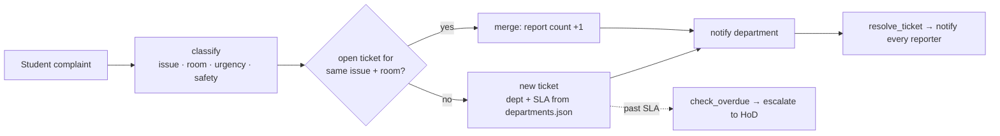

# CampusOS

**An AI agent that doesn't just record campus complaints, it gets them fixed.**

wHACKiest 2026 · Track 1: *Make MCP Matter* · Team CodeBrew

> 15 students report the same broken projector → 15 complaints, 1 projector, 0 updates.
> CampusOS turns them into **one ticket ×15**, routes it to the right team, escalates it when overdue,
> and tells all 15 students when it's fixed.

---

## The problem

Projectors, Wi-Fi, water coolers, hostel repairs, sparking switchboards: students report them on
Google Forms, registers and WhatsApp groups. Those tools only *record*. Nobody owns the issue,
duplicates pile up, nothing escalates and students never hear back, so they stop reporting.

## What CampusOS does

1. **Understand**: reads a complaint and extracts issue, building, room, urgency and safety risk
2. **Merge**: finds the open ticket for the same issue and adds to its report count instead of creating a duplicate
3. **Assign**: routes to the right department with an SLA deadline
4. **Safety fast lane**: sparks, exposed wires, smoke → `critical`, 2-hour SLA
5. **Escalate**: overdue tickets go to the HoD / facility head
6. **Close the loop**: when fixed, every student who reported it is notified

It is built as an **MCP server**, so any MCP client (a desktop AI assistant, a voice agent, an
admin bot) can operate campus maintenance through a small set of controlled tools.

## Run the prototype

Requires Node.js 18+.

```bash
npm install
npm start          # web app → http://localhost:3000
```

**Web app:** students report an issue on the left. The admin ticket board on the right shows tickets
with report counts (×15), department, deadline, urgency and safety flags, and safety hazards at the top.
- **Load demo** sends the 18 sample complaints.
- **Simulate +30 hours** escalates overdue tickets.
- **Mark fixed** closes a ticket and notifies every reporter.

### Terminal demo

```bash
npm run demo
```

The terminal demo sends 18 complaints (15 about the same projector, plus Wi-Fi, a leaking cooler and a
sparking switchboard), then fast-forwards 30 hours and fixes the projector:

```
NEW     T1001  x1   "Projector in C-204 not working"
MERGED  T1001  x2   "C-204 projector shows no display"
...
MERGED  T1001  x15  "C204 projector problem again!!"
NEW     T1004  x1   "Sparks coming from the switchboard in B-110!"   -> critical, safety

=== 30 hours later ===
{ escalated: [ 'T1001', 'T1002', 'T1003', 'T1004' ] }

=== Technician fixes the projector ===
T1001 -> resolved; 15 students notified
```

`npm run demo` resets `data/db.json` every time.

### Run as an MCP server

```bash
npm run mcp                                                   # stdio server
npx @modelcontextprotocol/inspector node src/mcp-server.js    # try the tools in a browser
```

| Tool | What it does |
|---|---|
| `report_issue` | Classify a complaint, merge it into a matching open ticket or create one, assign the department |
| `list_tickets` | List tickets (`open` / `escalated` / `resolved` / `all`), most-reported first |
| `check_overdue` | Escalate every open ticket past its SLA |
| `resolve_ticket` | Mark a ticket fixed and notify everyone who reported it |

### Optional: LLM classification

Without a key, CampusOS uses a built-in keyword classifier, so the demo works offline.
To use an LLM, copy `.env.example` to `.env` and set `LLM_API_KEY`, `LLM_BASE_URL` and `LLM_MODEL`
(any OpenAI-compatible API). If the call fails it falls back to keywords.

## How it works



| File | Role |
|---|---|
| `src/classify.js` | LLM triage (complaint text treated as data, never instructions) + keyword fallback, safety flag |
| `src/agent.js` | classify → dedup → merge/create → assign → notify; escalation; resolve |
| `public/index.html` | Web UI: report form + admin ticket board |
| `src/server.js` | Web backend: JSON API (`/api/report`, `/api/tickets`, `/api/check-overdue`, `/api/resolve`) on Node's `http` |
| `src/mcp-server.js` | The four MCP tools over stdio (same agent logic) |
| `src/store.js` | JSON-file store |
| `data/departments.json` | Category → department, email, SLA hours |
| `scripts/demo.js` · `data/demo-complaints.json` | The 15-projector demo |

**Guardrails already in the prototype:** complaint text is never treated as instructions;
low-confidence classifications are flagged `needsHumanReview`; tools are a fixed allowlist.

## Prototype scope vs. hack day

| Tonight (this repo) | Hack day (1–2 Dec) |
|---|---|
| Text complaints | Photos (vision LLM) and Kannada/Hindi voice notes (ElevenLabs Scribe) |
| Keyword / any LLM classification | Amazon Bedrock |
| Dedup = same category + building + room | Embeddings (pgvector) + LLM "same issue?" check |
| JSON file | Supabase Postgres |
| Notifications logged | Email (SES), WhatsApp (Twilio), voice replies (ElevenLabs TTS) |
| `check_overdue` called manually | AWS EventBridge timers |
| MCP over stdio | MCP over HTTP for an ElevenLabs voice agent |
| Basic web app (plain HTML + Node `http`) | React app with login (USN), live dashboard (Supabase Realtime), proof-of-fix photo check, audit log |

Full idea, research and plan: [`docs/CAMPUSOS_KNOWLEDGE.md`](docs/CAMPUSOS_KNOWLEDGE.md) ·
[`docs/BUILD_PHASE_PLAN.md`](docs/BUILD_PHASE_PLAN.md)

## Team CodeBrew

| Name | Role |
|---|---|
| _TBD_ | |
| _TBD_ | |

College: _TBD_
